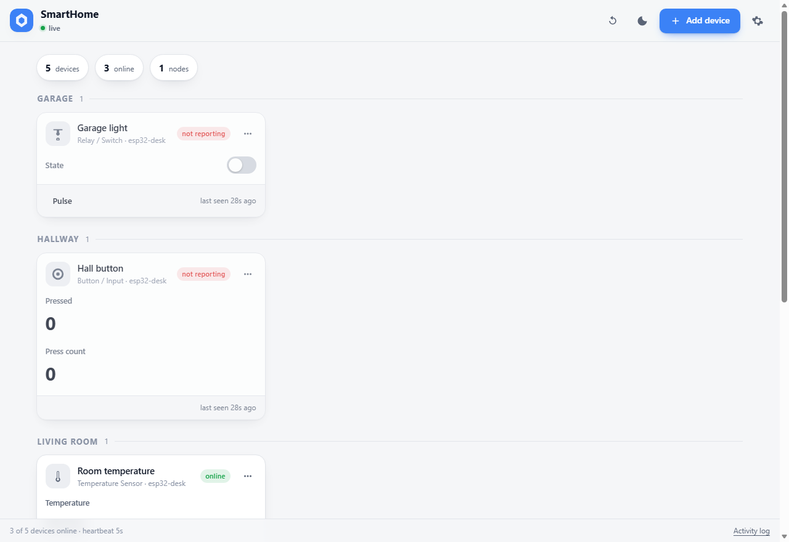
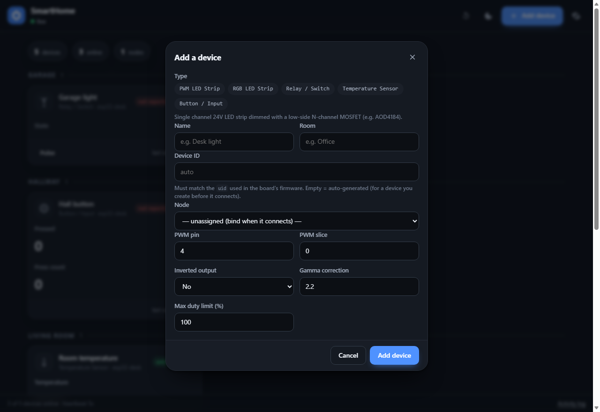
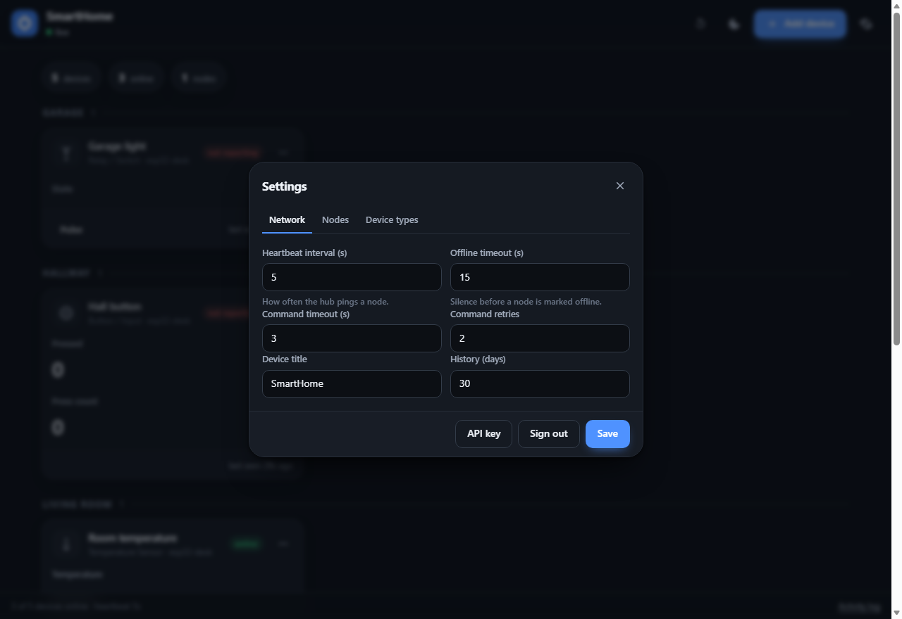
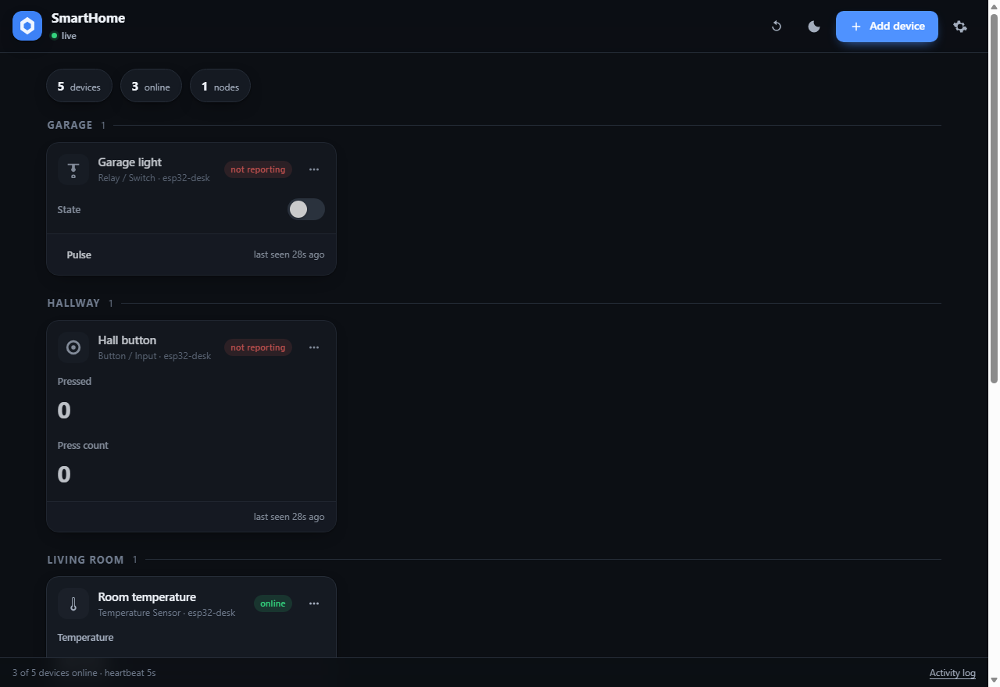

# SmartHome

A small, self-hosted smart-home hub for a Raspberry Pi 5 and microcontroller
nodes (ESP32-C6 / ESP32-S3 / Pico 2 W).  The hub serves a web UI, keeps the
desired state of every device, and keeps the hardware in sync over a
reconnecting WebSocket.  Device *types* are JSON manifests plus a small
MicroPython driver, so adding new hardware never means touching the server or
the UI.

```
┌──────────────────────────┐        WebSocket / JSON        ┌────────────────────┐
│  Raspberry Pi 5          │  ws://pi:8080/ws/node?token=…  │  ESP32-C6          │
│  smarthome hub           │◄──────────────────────────────►│  shnode firmware   │
│  ─ SQLite state/history  │                                │  ─ pwm_led_strip   │
│  ─ device type manifests │        HTTP + WebSocket        │  ─ relay / button  │
│  ─ REST API + web UI     │◄──────────────────────────────►│  ─ temp sensor     │
└──────────────────────────┘        browser (UI)            └────────────────────┘
```

## Why it looks like this

| Concern | Decision |
| --- | --- |
| Losing Wi-Fi or power | The hub stores **desired** state; every reconnect reconciles the hardware back to it. |
| Silent failures | Commands are **acknowledged**.  No ack → retry → a visible error on the card. |
| Half-dead nodes | Heartbeat pings with an RTT reading; silence past the timeout marks the node offline. |
| Losing the Pi | SQLite in WAL mode, atomic config writes, `python -m smarthome backup`. |
| Adding hardware | One JSON manifest in `device_types/` + one driver class.  No UI or server change. |
| Untrusted LAN | Password login, per-node tokens (stored hashed), constant-time comparisons. |

## Quick start (Raspberry Pi)

```bash
git clone <your-repo> smarthome && cd smarthome
sudo ./deploy/install.sh
```

The installer creates a `smarthome` user, a virtualenv, `/var/lib/smarthome`,
and a systemd unit.  It prints the generated admin password once:

```bash
sudo journalctl -u smarthome -n 40 --no-pager | grep -A2 "Admin password"
```

Then open `http://<pi-ip>:8080`.



Device cards are generated from the type manifests — the screenshot above has
a PWM strip with power and brightness, a relay, a temperature reading and two
devices whose board is not powered (the "offline" badge).

| Add a device | Settings |
| --- | --- |
|  |  |

Dark theme follows the system preference (or the button in the header):



### Running by hand (development)

```bash
python3 -m venv .venv && . .venv/bin/activate
pip install -r requirements-dev.txt
python -m smarthome serve --host 0.0.0.0 --port 8080
```

Data lives in `~/.smarthome` (`config.json`, `smarthome.db`) unless
`SMARTHOME_CONFIG` or `SMARTHOME_DATA_DIR` says otherwise.

## How to add a device type

Two files, no server changes.

**1. `device_types/my_thing.json`** – the contract (properties, ranges, UI
control hints, hardware config schema, actions, events):

```json
{
  "id": "my_thing",
  "name": "My Thing",
  "category": "light",
  "icon": "bulb",
  "properties": {
    "power": {"type": "bool", "default": false, "control": "switch"},
    "speed": {"type": "int", "min": 0, "max": 100, "default": 50, "unit": "%",
              "control": "slider"}
  },
  "config": {
    "pin": {"type": "int", "min": 0, "max": 48, "default": 4, "required": true}
  },
  "actions": {"identify": {"label": "Blink", "args": {}}},
  "events": {"button": {"label": "Button"}}
}
```

Accepted `control` values: `switch`, `slider`, `number`, `select`, `color`,
`text`, `readonly`.  Property types: `bool`, `int`, `float`, `string`, `enum`.
Set `"advanced": true` to hide a property behind the device's Advanced tab, and
`"settable": false` for read-only state (sensors).

Drop the file into `device_types/` on the Pi and press **Settings → Device
types → Reload manifests**, or restart the hub.  The card, its controls and its
API validation appear automatically.

**2. `micropython/shnode/devices/my_thing.py`** – the hardware side:

```python
from ..compat import sleep_ms
from ..device import DeviceError
from .base import Driver, make_pwm

class MyThing(Driver):
    type = "my_thing"
    settable = ("power", "speed")

    def __init__(self, uid, config=None, *, name=None):
        super().__init__(uid, config, name=name)
        self.pin = int(self.config.get("pin", 4))
        self._pwm = None
        self.state = {"power": False, "speed": 50}

    def setup(self):
        self._pwm = make_pwm(self.pin, frequency=1000)

    def teardown(self):
        if self._pwm:
            self._pwm.duty_u16(0)
            self._pwm.deinit()

    def apply(self, props):
        if "speed" in props:
            speed = int(props.pop("speed"))
            if not 0 <= speed <= 100:
                raise DeviceError("speed must be 0..100")
            self.state["speed"] = speed
        if "power" in props:
            self.state["power"] = bool(props.pop("power"))
        if props:
            raise DeviceError("unsupported properties %s" % (sorted(props),))
        self._pwm.duty_u16(self.state["speed"] * 655 if self.state["power"] else 0)

    async def action_identify(self):
        for _ in range(3):
            self._pwm.duty_u16(65535)
            await sleep_ms(150)
            self._pwm.duty_u16(0)
            await sleep_ms(150)

    def snapshot(self):
        return {"power": self.state["power"], "speed": self.state["speed"]}
```

Then register it in `micropython/main.py` (`DEVICES` list + the `registry`
dict in `build_devices()`).

The driver API is:

| Hook | Purpose |
| --- | --- |
| `type` | manifest id this driver implements |
| `settable` | tuple of property names accepted from the hub |
| `setup()` / `teardown()` | hardware init / release |
| `apply(props)` | apply validated values; raise `DeviceError` to reject |
| `async loop()` + `poll_interval` | background work (sensors, buttons) |
| `async action_<name>(**args)` | hub actions |
| `snapshot()` | what the hub sees as *reported* state |
| `self.request_report()` | push a state change the driver noticed itself |
| `await self.emit(name, data)` | raise an event to the hub's activity log |

## Flashing a node

### The web flasher (easiest)

The board is plugged into *your computer*, not the Pi, so this runs locally:

```bash
pip install fastapi uvicorn esptool mpremote pyserial
python tools/flasher.py --open     # http://127.0.0.1:8090
```

Pick the detected port, fill in the hub address, Wi-Fi, device type and pin,
then press **Flash Micro Controller**.  Progress streams step by step (detect
→ erase → get MicroPython → write → wait for REPL → copy firmware → write
config → reboot → verify) with a live log.

It handles both families:

| Board | How it appears | What happens |
| --- | --- | --- |
| ESP32-C6 / C3 / S3 / … | COM port | esptool erases and writes the `.bin` (esptool 4.x and 5.x command names both supported) |
| Pico 2 W (RP2350) | USB drive in BOOTSEL mode | MicroPython `.uf2` is copied to the drive and the board reboots itself |

For a Pico: **hold BOOT, plug in USB, release BOOT** — it mounts as a drive
containing `INFO_UF2.TXT`.  There is no COM port in that mode.

The flasher writes `/config.json` and `/devices.json`; `main.py` reads
`devices.json` first, so you never edit firmware source to add a device.

### The command line

```bash
pip install mpremote
# copy library + boot/main and write /config.json in one go
python tools/flash_node.py --port COM5 --node esp32-desk \
    --server http://192.168.1.20:8080 \
    --wifi-ssid "MyWifi" --wifi-pass "secret" \
    --hub-password "admin-password" \
    --devices '[{"type":"pwm_led_strip","uid":"desk-strip","name":"Desk strip","config":{"pin":4}}]'
```

`--hub-password` asks the hub for a token, so you do not have to copy one by
hand.  Alternatively:

* press **Add device → Allow new devices** in the UI, power the board and it
  enrols itself (the token is written to `/config.json` on the board), or
* `python -m smarthome node-token esp32-desk` prints a token for manual use.

## Accounts

The hub supports multiple accounts, stored in SQLite (never in `config.json`),
so password changes apply immediately without restarting the service.

* **First run** — a fresh install shows a setup page and asks you to create the
  first administrator.
* **Upgrading** — an existing single-password install is migrated
  automatically: the old admin password becomes an `admin` account, and the
  password you already have keeps working.
* **Adding users** — as an administrator: **Settings → Users**, or
  ```bash
  python -m smarthome users add anna --role user
  python -m smarthome users                     # list accounts
  ```
* **Changing your own password** — **Settings → Account** (any user).
* **Resetting someone else's** — **Settings → Users → Reset password**, or
  ```bash
  python -m smarthome set-password anna
  ```
  A reset logs that user out everywhere, because the signed cookie carries a
  version stamp that moves whenever the password or role changes.

Two roles:

| Role | Can do |
| --- | --- |
| `user` | see and control devices, change their own password |
| `admin` | everything, plus users, device types, node tokens and settings |

The last administrator cannot be demoted or deleted, and nobody can delete
their own account.

## Node protocol

One JSON object per WebSocket text frame (see `smarthome/protocol.py`).

| Direction | Type | Meaning |
| --- | --- | --- |
| node → hub | `hello` | identity + every device it owns + current state |
| hub → node | `hello` | protocol version and timing parameters |
| hub → node | `cmd` | `{id, dev, props}`; must be acked |
| hub → node | `act` | `{id, dev, action, args}`; must be acked |
| hub → node | `ping` / `state_req` / `config` / `bye` | liveness, resync, retune, restart |
| node → hub | `ack` | `{id, ok, error?, state?}` |
| node → hub | `state` | `{dev, values}` – full state for that device |
| node → hub | `event` | `{dev, event, data}` – activity log |
| node → hub | `pong` | answers a ping |

Guarantees:

* **Commands are idempotent by id** – a retried command is applied once.
* **State is a full snapshot**, never a delta, so a lost frame self-heals on
  the next report.
* **Desired wins** – after a reconnect the hub re-sends any property whose
  desired value differs from what the device reports.
* **Unknown fields are ignored** on both sides, so a newer firmware and an
  older hub (or vice versa) still work.

## Configuration

`~/.smarthome/config.json` (or `$SMARTHOME_CONFIG`):

| Key | Default | Meaning |
| --- | --- | --- |
| `server.host` / `server.port` | `0.0.0.0` / `8080` | listen address |
| `server.behind_proxy` | `false` | trust `X-Forwarded-*` |
| `auth.session_ttl_hours` | `336` | how long a browser stays signed in |
| `auth.cookie_secure` | `false` | set when serving over HTTPS |
| `auth.require_node_tokens` | `true` | set `false` only on a trusted bench |
| `devices.heartbeat_s` | `10` | hub ping interval |
| `devices.report_s` | `30` | node's periodic full report |
| `devices.offline_after_s` | `40` | silence before a node is offline |
| `devices.ack_timeout_s` / `ack_retries` | `3.0` / `2` | command retry policy |
| `devices.history_days` | `30` | sensor history retention |

Most are editable at runtime in **Settings**; changes are pushed to connected
nodes immediately.

## API

Everything the UI does is available over HTTP with the session cookie, an
`X-API-Key` header, or `?key=`:

```bash
KEY=$(python -m smarthome apikey | tail -1)

curl -s -H "X-API-Key: $KEY" http://pi:8080/api/bootstrap | jq
curl -s -H "X-API-Key: $KEY" -X POST http://pi:8080/api/devices/desk-strip/props \
     -H 'Content-Type: application/json' -d '{"props":{"power":true,"brightness":40}}'
curl -s -H "X-API-Key: $KEY" "http://pi:8080/api/devices/desk-strip/history?hours=24"
```

| Method | Path | Purpose |
| --- | --- | --- |
| `POST` | `/api/login`, `/api/logout` | session cookie |
| `GET` | `/api/me` | who am I, and does this install need setup |
| `POST` | `/api/setup` | create the first administrator (empty install only) |
| `POST` | `/api/password` | change your own password |
| `GET`/`POST` | `/api/users` | list / create accounts *(admin)* |
| `PATCH`/`DELETE` | `/api/users/{username}` | role, display name, password reset, delete *(admin)* |
| `GET` | `/api/bootstrap` | devices, nodes, types, settings |
| `GET`/`POST` | `/api/devices` | list / create |
| `PATCH`/`DELETE` | `/api/devices/{uid}` | rename, re-room, re-wire, remove |
| `POST` | `/api/devices/{uid}/props` | set properties |
| `POST` | `/api/devices/{uid}/action` | run an action |
| `GET` | `/api/devices/{uid}/history?hours=` | sensor history |
| `GET` | `/api/events?limit=` | activity log |
| `GET` | `/api/nodes` | nodes and their state |
| `POST` | `/api/nodes/{id}/token`, `/revoke` | device tokens |
| `POST` | `/api/enroll` | open/close the enrolment window |
| `PATCH` | `/api/settings` | timing and title |
| `POST` | `/api/types/reload` | re-read manifests |
| `WS` | `/ws/ui` | live updates for browsers |

A wall tablet can stay signed in with `http://pi:8080/auth?key=<API key>` once.

## Project layout

```
smarthome/            hub (Python 3.9+, runs on Raspberry Pi OS)
  hub.py              sessions, desired/reported state, retries, history
  protocol.py         message schema and property validation
  registry.py         device type manifests -> validated types
  server.py           FastAPI app, REST, both WebSockets
  security.py         PBKDF2 passwords, session cookies, device tokens
  store.py            SQLite schema and queries
  web/                the UI (no build step: one HTML, one CSS, one JS)
device_types/         JSON manifests — the only thing you add for a new type
micropython/          node firmware
  main.py             per-board device list (the file you edit)
  boot.py             watchdog / safe boot
  shnode/             transport, agent, drivers
tools/                flasher.py (web UI), flash_node.py, fake_node.py
deploy/               systemd unit and installer
scripts/              dev helpers and verification tools
tests/                unit, API, driver and end-to-end tests
```

## Testing

```bash
pip install -r requirements-dev.txt
python -m pytest -q                      # 178 tests
python scripts/mpy_check.py               # compile firmware with MicroPython
python scripts/mpy_imports.py             # run firmware code under MicroPython
python -m tools.fake_node --server http://127.0.0.1:8080   # simulate a board
python scripts/rehearse.py http://pi:8080 <password>       # full strip rehearsal
```

| Suite | What it covers |
| --- | --- |
| `tests/test_protocol.py` | property coercion, ranges, unknown fields, read-only handling |
| `tests/test_security.py` | PBKDF2, session cookies, tampering, expiry |
| `tests/test_registry.py` | manifests load; bad ones are reported, not fatal |
| `tests/test_hub.py` | registration, ack/retry, reconcile, reconnect, watchdog, device ownership |
| `tests/test_server.py` | auth on every route, CRUD, validation, partial updates, both WebSockets |
| `tests/test_firmware_drivers.py` | gamma, fading, inversion, clamping, actions |
| `tests/test_transport.py` | URL parsing, frame masking, fragmentation, close codes |
| `tests/test_flash_tool.py` | the provisioning tool stages a compilable firmware tree |
| `tests/test_e2e.py` | the **real firmware** against a **real uvicorn server** |
| `tests/test_ui.py` | a real browser: cards, toggles, dialogs, phone viewport, layout geometry |
| `tests/test_xss.py` | a hostile manifest cannot inject HTML or script |

`scripts/rehearse.py` is the "would it work on my desk" script: it boots a
simulated ESP32-C6 with a 24 V strip, drives power/brightness/fades/frequency,
kills the link mid-change, reboots the hardware behind the hub's back, and
confirms the strip converges back to what you asked for (19 checks).

`tests/test_e2e.py` starts a real server and connects the real firmware to it
over a WebSocket, so reconnect, enrolment, acking, retries and state
reconciliation are all exercised end to end.  The browser tests are skipped
automatically on a machine without Chromium/Edge.

The firmware is also compiled and partly executed by a **real MicroPython
1.29** interpreter (`scripts/mpy_check.py`, `scripts/mpy_imports.py`), which
catches the syntax and stdlib differences a CPython-only suite would miss —
that is how `random.random()` and `task.exception()` were caught.  Those
scripts need a MicroPython binary:

```bash
conda install -c conda-forge micropython     # or: pip install mpremote (board side)
python scripts/mpy_check.py --interpreter /path/to/micropython
```

Visual check without a browser window:

```bash
python scripts/ui_dump.py http://pi:8080 --key $KEY   # prints the cards as text
python scripts/ui_test.py http://pi:8080 --key $KEY --screenshots docs/screenshots
```

The screenshots in `docs/screenshots/` were produced by the last command.


## Security notes

* Passwords are PBKDF2-SHA256 (240k iterations, random salt) and live in the
  SQLite database, never in `config.json`.
* Sessions are signed cookies (HMAC-SHA256) with an expiry and a per-user
  version stamp, so changing a password or role logs out other browsers.
  Device tokens are opaque and stored only as SHA-256 hashes.
* An unknown username and a wrong password return the same error, and take the
  same time, so the API does not reveal which accounts exist.
* Login attempts are throttled per client address.
* Node sockets require a token unless the enrolment window is open; an
  enrolment window only issues a token for a node that does not already have
  one.
* The hub has no internet dependency and no telemetry.

For access from outside the LAN put it behind a reverse proxy with HTTPS and
set `auth.cookie_secure: true`.

## Limitations / next steps

* History is recorded for sensor devices always, and sampled every 5 s for
  others (one row per change set); the UI shows the last 24 h.
* Groups, scenes and schedules are not implemented — the event log and the
  `actions` mechanism are the intended hook points.
* The firmware supports one hub at a time.
